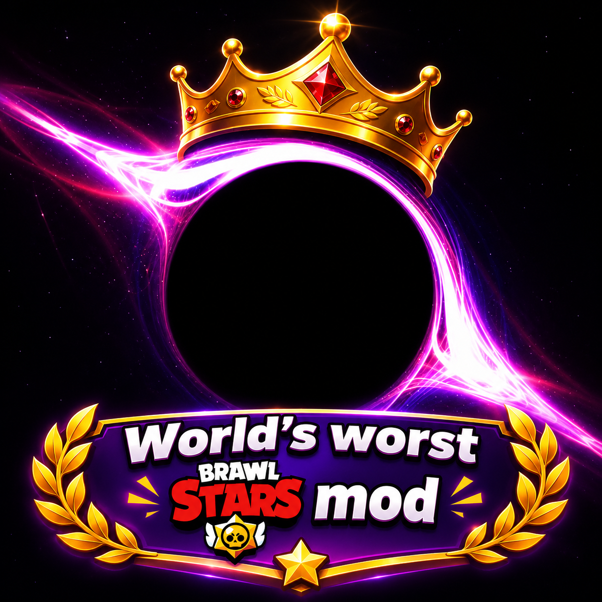

# CoreTools++

My new mod for Brawl Stars v70.648, developed in collaboration with GPT 5.6 Luna and Claude Haiku 4.5.

Fully functional and under active development!

# Donations for a new 4G modem (the previous one got stuck)

https://www.fidf.org

## Let me know if I should make an APK!

## Development

```sh
npm ci
npm run typecheck
npm run format:check
npm run build
```

The production bundle is `dist/agent.js`. `npm run build:dev` includes source maps;
`npm run watch` rebuilds during development. `npm run format` formats the source
and documentation with Prettier.

With the device connected and Frida available:

```sh
npm run spawn
# Or attach to an already running Gadget process:
frida -U -n Gadget -l dist/agent.js
```

